<!-- Don't delete it -->
<div name="readme-top"></div>

<!-- Organization Logo -->
<div align="center" style="display: flex; align-items: center; justify-content: center; gap: 16px;">
  
  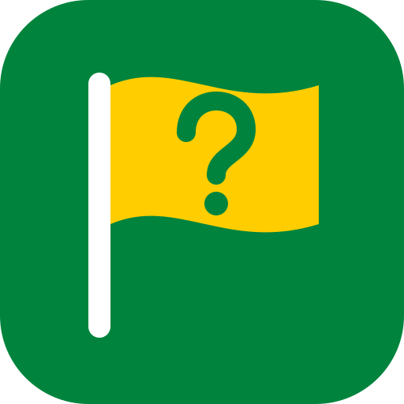
</div>

&nbsp;

<!-- Organization Name -->
<div align="center">

[](https://flagquiz.aossie.org/)

<!-- Correct deployed url to be added -->

</div>

<!-- Organization/Project Social Handles -->
<p align="center">
<!-- Telegram -->
<a href="https://t.me/+bMWGzaMTMa8xN2Ex">
</a>
&nbsp;&nbsp;
<!-- X (formerly Twitter) -->
<a href="https://x.com/aossie_org">
</a>
&nbsp;&nbsp;
<!-- Discord -->
<a href="https://discord.gg/hjUhu33uAn">
</a>
&nbsp;&nbsp;
<!-- LinkedIn -->
<a href="https://www.linkedin.com/company/aossie/">
  </a>
&nbsp;&nbsp;
<!-- Youtube -->
<a href="https://www.youtube.com/@AOSSIE-Org">
  </a>
</p>


<p align="center">
  <a href="https://scorecard.dev/viewer/?uri=github.com/AOSSIE-Org/FlagQuiz">
    </a>
  &nbsp;&nbsp;
  <a href="./BestPracticesChecklist.md">
    </a>
  &nbsp;&nbsp;
  <a href="https://github.com/gitleaks/gitleaks">
    </a>
</p>

---


<div align="center">
<h1>Flag Quiz</h1>
</div>

[Flag Quiz](https://flagquiz.aossie.org/) is a simple, purely local web game for children to learn the flags, locations and capitals of all the countries and territories of the world. It uses big icons instead of text, reads names aloud, adapts to what each child already knows, and keeps all data on the device.

---

## 🚀 Features

- **Five games**:
  - *Guess the Flag*: a country name is shown (and read aloud) and the child picks its flag.
  - *Guess the Country*: a flag is shown and the child picks the country's name.
  - *Guess the Location*: a country's name and flag are shown and the child taps it on a world map. A wrong country shows its own name and flag on the map. Tiny countries have round markers that are easy to tap, and the map can be zoomed (wheel, pinch or ＋/－) and dragged.
  - *Guess the Capital*: a country's name and flag are shown and the child picks its capital, each shown with its name and four photos of the city and its landmarks (e.g. the Eiffel Tower for Paris).
  - *Guess the Capital's Country*: a capital and its four photos are shown and the child picks the country.
- **Every flag in the world**: 234 ISO 3166-1 countries and territories, with their real proportions.
- **77 languages**: every language that browsers have text-to-speech voices for and that the Unicode CLDR names countries in, starting with the most spoken languages in the world ([Wikipedia/Ethnologue](https://en.wikipedia.org/wiki/List_of_languages_by_total_number_of_speakers)): English (default), Afrikaans, Albanian, Amharic, Arabic, Armenian, Azerbaijani, Basque, Bengali, Bosnian, Bulgarian, Burmese, Cantonese, Catalan, Croatian, Czech, Danish, Dutch, Estonian, Filipino, Finnish, French, Galician, Georgian, German, Greek, Gujarati, Hebrew, Hindi, Hungarian, Icelandic, Indonesian, Irish, Italian, Japanese, Javanese, Kannada, Kazakh, Khmer, Korean, Lao, Latvian, Lithuanian, Macedonian, Malay, Malayalam, Maltese, Mandarin Chinese, Marathi, Mongolian, Nepali, Norwegian, Pashto, Persian, Polish, Portuguese, Romanian, Russian, Serbian, Sinhala, Slovak, Slovenian, Somali, Spanish, Sundanese, Swahili, Swedish, Tamil, Telugu, Thai, Turkish, Ukrainian, Urdu, Uzbek, Vietnamese, Welsh and Zulu. Some languages have voices only on some devices (e.g. in Microsoft Edge); elsewhere names are shown but may not be read aloud. The language is chosen with 文A in the menu or in the player picker, which lists the languages by their own names (English first, then alphabetically). Country and continent names come from the Unicode CLDR, capital names from Wikidata, Arabic, Hebrew, Pashto, Persian and Urdu are laid out right to left, names are read aloud with a voice for the chosen language, and the credits page is translated too.
- **Spoken names**: names are read aloud on hover or tap, using the device's own text-to-speech voices. An option is only read when the mouse moves onto it, not when a new round puts it under a mouse that hasn't moved.
- **Clear feedback**: correct answers get a green check and a chime, and the next round starts after 1 s. A wrong pick turns red and shows (and says) what was actually picked.
- **Adaptive practice**: every country has a difficulty score per player and game, which starts at 0.5 and moves 10% towards 1 after each mistake and 10% towards 0 after each correct guess. Rounds without mistakes make the next questions harder; mistakes make them easier.
- **Three difficulty levels**: 3, 6 or 9 options per round.
- **Choose the countries**: practise only some continents, and only the N most populous countries (all continents and the top 100 by default).
- **Multiple players**: each player has a name and a custom flag (3 colours, from a palette or any colour, and 12 patterns with stripes, crosses, circles, rhombuses, stars and moons). The current player's name and flag are shown top right.
- **Multiplayer mode**: several children take turns on one device. A player keeps playing until they make a mistake, or until they have played the maximum number of rounds in a row (3 by default, set next to the player selection); then it's the next player's turn. Each player keeps their own difficulty level (3, 6 or 9 options), so children of different ages can play together, and players with the lowest best run of gold stars play first.
- **Scores** (top left): 🔥 days played in a row; for the current game, a gold ⭐ for every round in a row without mistakes (a mistake resets them to 0), a silver ⭐ for every round without mistakes (a mistake takes away only one, never going below 0), and a gold ✅ for every correct answer; and a green ✅ for every correct answer in all games.
- **Statistics**: the days-in-a-row streak and its best, a 4-week calendar, and a table with, for each game, the most silver stars, the most gold stars and the flags of every mastered country (difficulty score below 0.2).
- **Grown-ups only: deleting players**: a small, faded 🗑 button in the player picker; deleting a player requires solving an equation such as `7x − 23 = 2x + 52`.
- **Sound controls**: menu switches for reading names aloud and for sound effects.
- **Save and load players**: export a player's data as a JSON file and import it on another device or browser. Grown-ups can also save **all players in one file** (a small, faded button in the player picker) and load it back with the same ⬆️ button.
- **Safe updates**: when a new version has been downloaded, a gold ↻ button appears in the lower-right corner; the new version starts when it is tapped, never in the middle of a game, and players' progress is kept. Saved data from every earlier version is migrated automatically and tested against recorded examples (`src/lib/fixtures/`). If an outdated copy of the app finds data saved by a newer one, it asks to be updated instead of showing no players; if an older copy is open in another tab, the app asks to close it. The app asks the browser to keep its storage persistent.
- **Share**: share the app with the device's share sheet (or copy its link).
- **Light and dark mode**, with AOSSIE's brand colours and font.
- **Fits on one screen**: no scrolling on desktop or on phones in landscape. A discreet button in the lower-right corner switches to full screen (where the browser supports it).
- **Works offline and installs like an app**: a Progressive Web App that also works as a plain static website. On phones and tablets, an "Install app" menu button shows the browser's install dialog (Android) or how to use Share → Add to Home Screen (iOS).
- **Splash screen** with the app's logo and name and "made by" AOSSIE's logo.
- **Credits and donations**: a credits page (ⓘ in the menu) with every data source and photo licence, and a ☕ menu item to support AOSSIE, a not-for-profit, at [buymeacoffee.com/aossie](https://buymeacoffee.com/aossie).
- **Private by design**: no accounts, no servers, no analytics. Everything is stored in the browser's IndexedDB.

---

## 💻 Tech Stack

### Frontend
- [Svelte 5](https://svelte.dev/) (runes) + TypeScript
- [Vite](https://vite.dev/) build tool
- [vite-plugin-pwa](https://vite-pwa-org.netlify.app/) (Workbox) for offline support and installation
- [Lucide](https://lucide.dev/) icons and the [Inter](https://rsms.me/inter/) typeface (bundled, no CDN)

### Browser APIs
- **IndexedDB** (through [`idb`](https://github.com/jakearchibald/idb)) for players, statistics and play dates
- **Web Speech API** (`speechSynthesis`) to read names aloud
- **Web Audio API** for the feedback sounds (generated in code, no audio files)
- **Fullscreen API** for the full-screen button, and `beforeinstallprompt` for installing on Android

### Data
- Flags from [hampusborgos/country-flags](https://github.com/hampusborgos/country-flags) (public domain, taken from Wikimedia Commons), optimised with SVGO
- Populations and continents from [GeoNames](https://www.geonames.org/) (CC BY 4.0). The populations agree within 10% with the World Bank's 2024 figures for all 216 countries in both datasets. Russia, Türkiye, Kazakhstan, Egypt, Azerbaijan and Georgia are listed under both of their continents.
- Both are downloaded and generated by [`scripts/fetch-countries.mjs`](scripts/fetch-countries.mjs) into `public/flags/` and `src/data/countries.ts`
- Capitals from [Wikidata](https://www.wikidata.org/) (CC0), using each country's best-rank capital, with a few curated choices where there are several (Pretoria, Sucre, Sri Jayawardenepura Kotte, Sanaa, Mbabane, Brades). Israel and Palestine, whose capitals are contested, are left out of the capital games.
- Photos of capitals from [Wikimedia Commons](https://commons.wikimedia.org/), all freely licensed: the city's main Wikidata image plus its most famous landmarks (buildings, monuments, museums, parks, squares, attractions located in the city, ranked by the number of Wikipedia editions about them). Photos are filtered for young children (no war, violence, prisons, slavery, genocide or adult topics), duplicates are removed, and a few Wikidata errors are corrected in the script (e.g. Managua, Malabo, St. John's) after a manual review of every capital's photos. 215 capitals have four suitable photos; the others (mostly tiny territories, plus Diego Garcia, a military base) are left out of the capital games. Authors and licences are listed in the app's credits page (`credits.html`, ⓘ in the menu). Generated by [`scripts/fetch-capitals.mjs`](scripts/fetch-capitals.mjs).
- Names in other languages: countries and continents from the [Unicode CLDR](https://cldr.unicode.org/) (via Node's ICU, with a few simpler names for children, e.g. "République démocratique du Congo" instead of "Congo-Kinshasa"), capitals from [Wikidata](https://www.wikidata.org/) labels (CC0), generated by [`scripts/fetch-names.mjs`](scripts/fetch-names.mjs) into `src/locales/names/`. A few capitals without a label in a language keep their English name.
- World map from [Natural Earth](https://www.naturalearthdata.com/) 1:50m (public domain) via [world-atlas](https://github.com/topojson/world-atlas), simplified and projected with d3-geo by [`scripts/fetch-map.mjs`](scripts/fetch-map.mjs)

### Testing
- [Vitest](https://vitest.dev/) with [`fake-indexeddb`](https://github.com/dumbmatter/fakeIndexedDB)
- [`svelte-check`](https://github.com/sveltejs/language-tools) for type checking

---

## ✅ Project Checklist

- [x] **The web app**:
   - [x] uses the colours and typeface of the [AOSSIE brand guidelines](https://github.com/AOSSIE-Org/Info/blob/main/Brand.md).
   - [x] has good metadata and a preview image for sharing on social media (Open Graph, X/Twitter cards).
   - [x] works offline and can be installed as a PWA.
   - [x] stores all data locally (IndexedDB) and makes no network requests at runtime.
   - [x] fits on one screen on desktop and on phones in landscape.
   - [x] is deployed to [flagquiz.aossie.org](https://flagquiz.aossie.org/).

---

## 🔗 Repository Links

1. [Main Repository](https://github.com/AOSSIE-Org/FlagQuiz) (the frontend is the whole app; there is no backend)

---

## 🏗️ Architecture Diagram

Flag Quiz is a single static page. There is no backend: all logic runs in the browser.

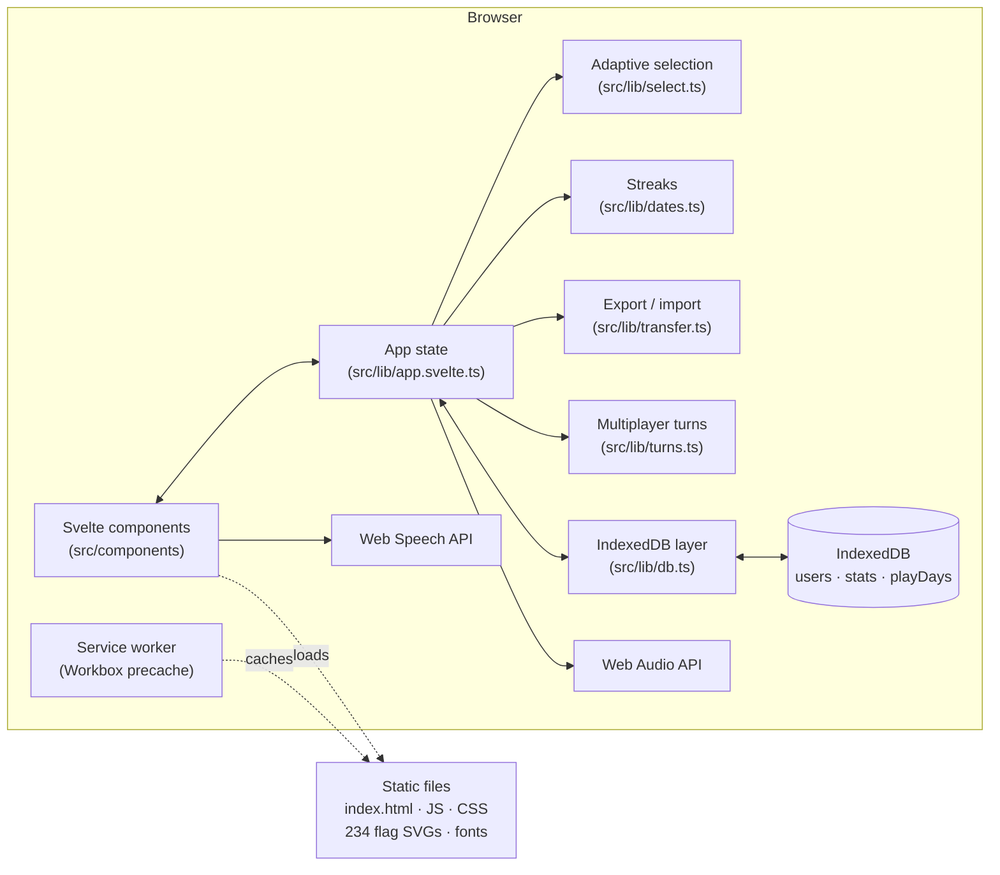

**Data model** (IndexedDB database `flag-quiz`):

| Store | Key | Value |
| --- | --- | --- |
| `users` | `id` (auto) | name, custom flag, difficulty, theme, countries filter, adaptive exponent per game, current/best rounds without mistakes |
| `stats` | `[userId, game, code]` | difficulty score `s`, and `c` (correct) and `d` (incorrect) counts |
| `playDays` | `[userId, date]` | local dates (`YYYY-MM-DD`) on which the player played |

**Difficulty score**: every country starts at `s = 0.5` for each player and game. After each guess, `s' = 0.9·s + 0.1·z`, where `z = 1` if the guess was incorrect and `z = 0` if it was correct. A country is *mastered* when `s < 0.2` (at least 9 correct guesses in a row from the start).

**Guesses**: in a round, the target counts as correctly guessed if it was found with no mistakes. Otherwise it counts as incorrectly guessed (once per round), and every wrongly picked option also counts as incorrectly guessed.

**Countries filter**: only countries on the selected continents can be asked, restricted to the N most populous among them. When the filter leaves fewer countries than options, the remaining options come from the rest of the world.

**Adaptive selection**: each round, the target and the other options are drawn from the filtered countries with weight `s^k`. The exponent `k` (from −3 to 4, starting at 1, kept per player and game) goes up by 0.5 after a round without mistakes and down by 0.5 for each mistake, so harder or easier flags come up more often. Recent targets are not repeated (the last 15, or fewer when the filter leaves few countries).

**Multiplayer**: the players of a session are ordered by their best number of rounds without mistakes (lowest first, ties in selection order) and play in round-robin. A correct answer keeps the turn. A mistake reveals the right answer for 1.5 s, then a banner shows and says the next player's name, and a new round starts with that player's difficulty, countries filter and statistics. Light/dark mode applies to everyone.

**Export format**: a JSON file `{ format: "flag-quiz-player", version: 1, player, stats, playDays }`. Imported files are validated before anything is saved, and an import always creates a new player.

---

## 🔄 User Flow

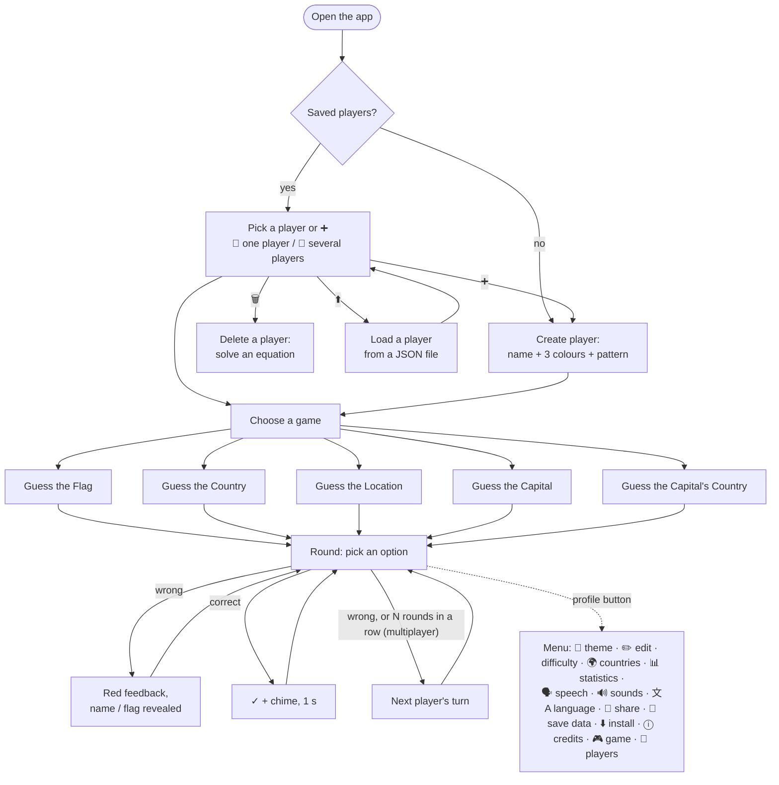

### Key User Journeys

1. **First time**:
   - The app opens the "new player" dialog.
   - The child types a name, picks 3 colours and a pattern, and taps ✓.
   - The child picks a game, which starts right away.

2. **Playing Guess the Flag**:
   - A country name is shown and read aloud (tap or hover over it to hear it again).
   - The child taps a flag. A wrong flag gets a red border, and its country's name is shown below it and read aloud.
   - The correct flag gets a green check and a chime. A new round starts 1 s later.

3. **Playing Guess the Country**:
   - A flag is shown, with 3, 6 or 9 country names below it (hover, or tap 🔊 on touch screens, to hear a name).
   - A wrong name turns red, and its flag appears below it.
   - The correct name turns green, and a new round starts 1 s later. The name under a mouse that hasn't moved is not read aloud until the mouse leaves it and comes back.

4. **Checking progress / settings**:
   - The scores are always shown at the top left: 🔥 days in a row, gold and silver ⭐ and gold ✅ for the current game, green ✅ for all games.
   - Tapping the profile flag (top right) opens the menu: theme, edit player, difficulty (tap to cycle 3 → 6 → 9 options), countries (continents and top N by population), statistics, speech, sounds, language, share, save data, install, credits, donate, change game, switch player.

5. **Guess the Location / Capital / Capital's Country**:
   - On the map, a wrong tap colours that country red and shows its name and flag where it is. Tiny countries are round markers; zoom in with the wheel, a pinch or ＋, and drag to move.
   - In the capital games, each capital shows four photos of the city and its landmarks; a wrong pick shows whose capital it is (or the capital of the chosen country).

6. **Playing together**:
   - In the "Who is playing?" dialog, switch from 👤 to 👥, tap the players who will play (each gets a ✓), choose how many rounds in a row each player may play (🔁 − 3 +), then ▶.
   - The player with the lowest best run starts. Their name and flag are shown top right, with the next players' flags below.
   - After a mistake, the right answer is shown, then the next player's flag and name appear (and the name is said aloud).

7. **Grown-ups**:
   - To delete a player, tap the small 🗑 in the "Who is playing?" dialog, tap the player, and solve the equation.
   - To install the app on a phone or tablet, use ⬇️ in the menu.

8. **Moving to another device**:
   - In the menu, 💾 saves the player's data as a JSON file.
   - On the other device, the ⬆️ button in the "Who is playing?" dialog loads that file as a new player.

---

## 🍀 Getting Started

### Prerequisites

- [Node.js](https://nodejs.org/) 20 or newer (with npm)
- Git
- A modern browser (Chrome, Edge, Firefox or Safari)

No accounts, API keys or environment variables are needed.

### Installation

#### 1. Clone the Repository

```bash
git clone https://github.com/AOSSIE-Org/FlagQuiz.git
cd FlagQuiz
```

#### 2. Install Dependencies

```bash
npm install
```

#### 3. Run the Development Server

```bash
npm run dev
```

#### 4. Open your Browser

Navigate to [http://localhost:5173](http://localhost:5173) to see the application.

### Other Commands

| Command | Description |
| --- | --- |
| `npm run build` | Production build in `dist/` (static files + service worker) |
| `npm run preview` | Serve the production build locally (to test PWA/offline) |
| `npm run check` | Type-check Svelte and TypeScript |
| `npm test` | Run the unit tests |
| `npm run fetch-countries` | Download the flags, populations and continents again and regenerate `src/data/countries.ts` |
| `npm run fetch-capitals` | Download the capitals and their photos again (`public/capitals/`, `src/data/capitals.ts`, `public/credits.html`); `-- --only=FR,GB` updates some countries only |
| `npm run fetch-map` | Regenerate the world map (`src/data/map.json`) |
| `npm run fetch-names` | Regenerate the names of countries, capitals and continents in every language (`src/locales/names/`) |
| `npm run build-credits` | Regenerate the credits page (`public/credits.html`) from the data files |

### Deployment

Every push to `main` is built, tested and deployed to [flagquiz.aossie.org](https://flagquiz.aossie.org/) by the [Deploy to GitHub Pages](.github/workflows/deploy.yml) workflow (the repository's Pages source must be set to "GitHub Actions").

`npm run build` produces a fully static site in `dist/` with relative paths, so it can be served from any static host and any sub-folder (GitHub Pages, Netlify, nginx, …).

- Over **HTTPS** (or on `localhost`), the service worker is registered: the app works offline and can be installed.
- Over plain HTTP, the app still works as a normal website.
- Everything the app needs (about 18 MB, mostly the photos of capitals) is downloaded in the background when the app is first opened or installed, so all games work offline.
- The social media metadata in `index.html` points to `https://flagquiz.aossie.org/` and `https://flagquiz.aossie.org/og-image.png`. Update these if the app is deployed elsewhere.

---

## 📱 App Screenshots

| | | |
|---|---|---|
| 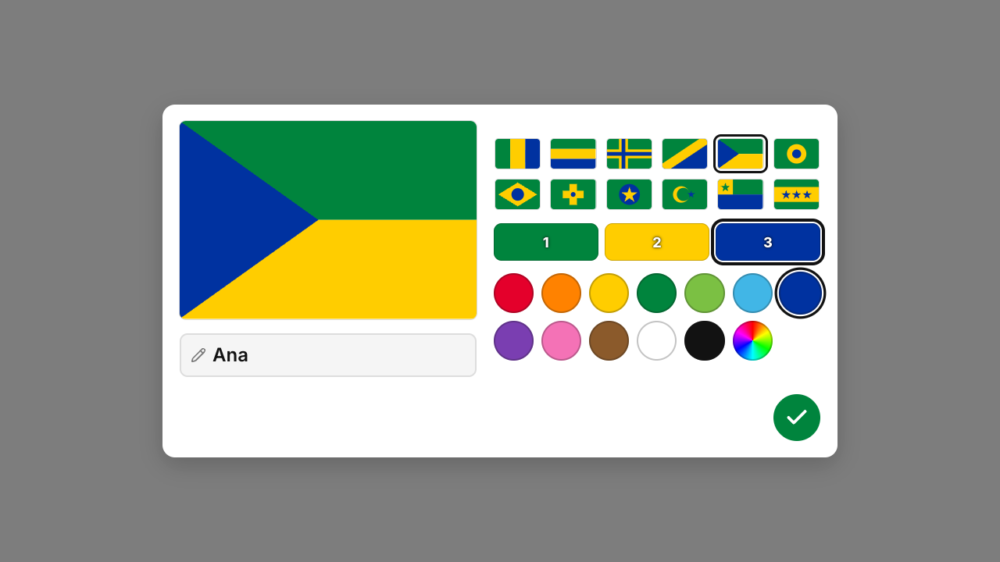 | 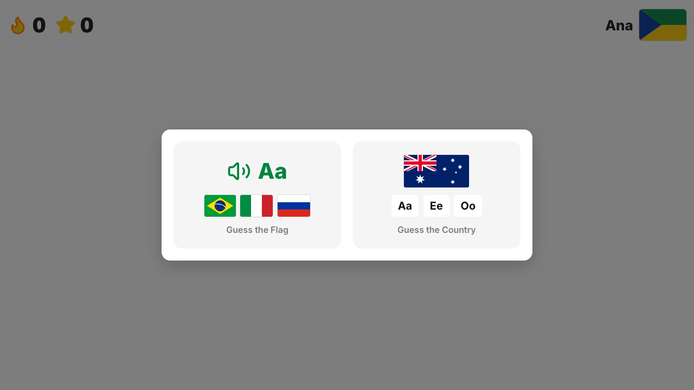 | 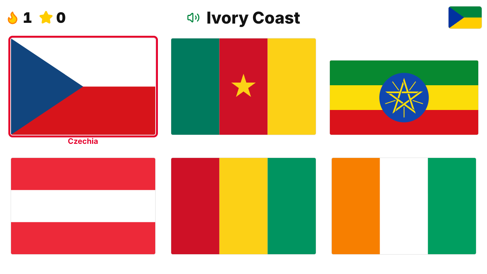 |
| New player | Choose a game | Guess the Flag |
| 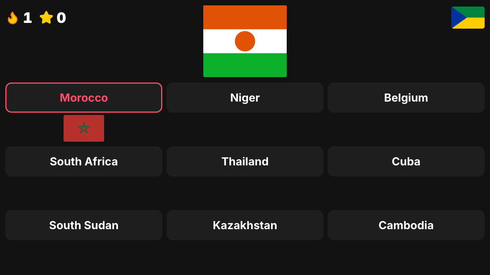 | 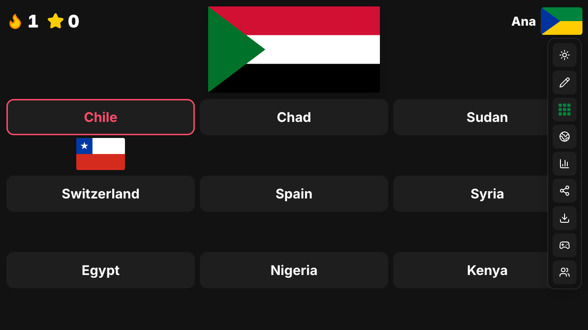 | 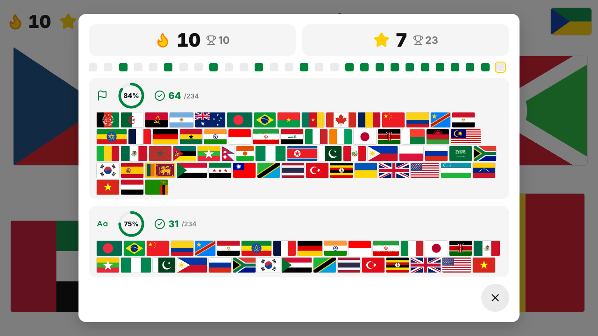 |
| Guess the Country (dark mode, hard) | Menu | Statistics |
| 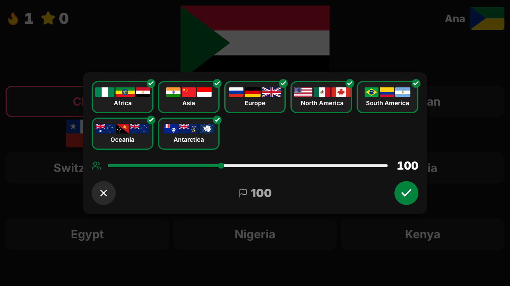 | 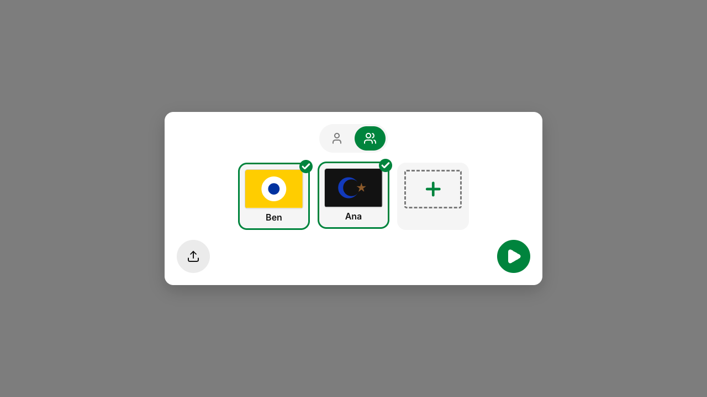 | 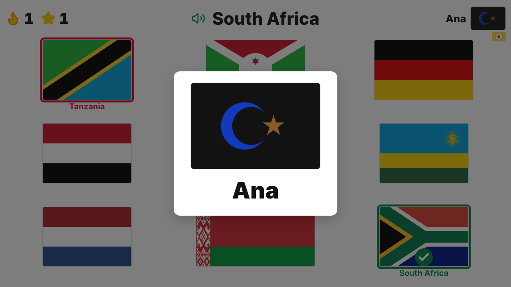 |
| Choose continents and top N by population | Multiplayer: choose players | Multiplayer: next player's turn |
| 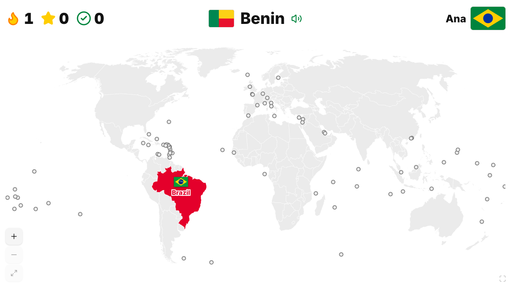 | 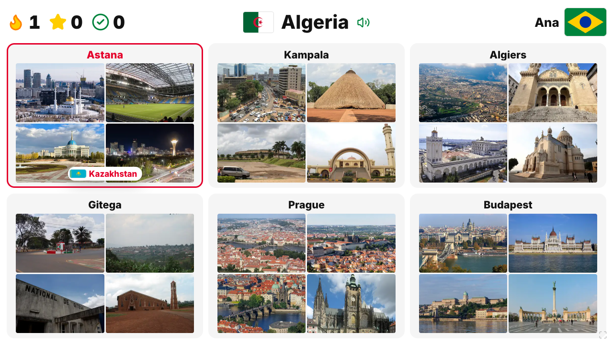 | 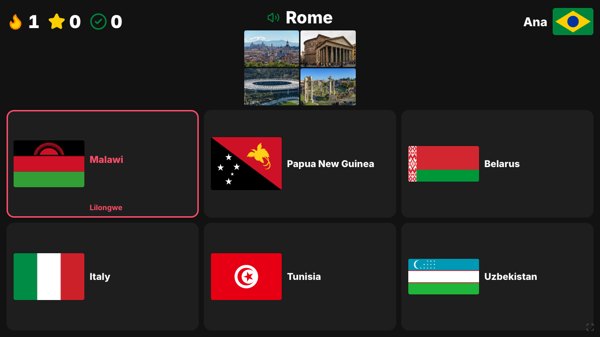 |
| Guess the Location | Guess the Capital | Guess the Capital's Country |
| 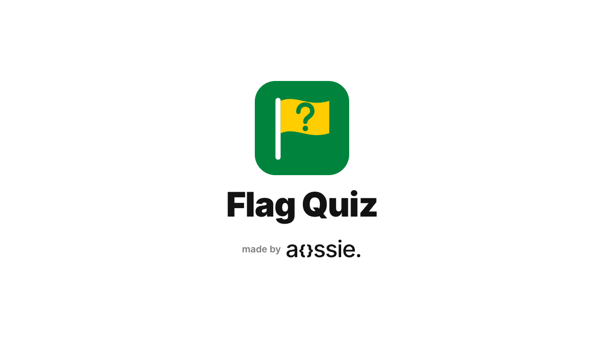 | 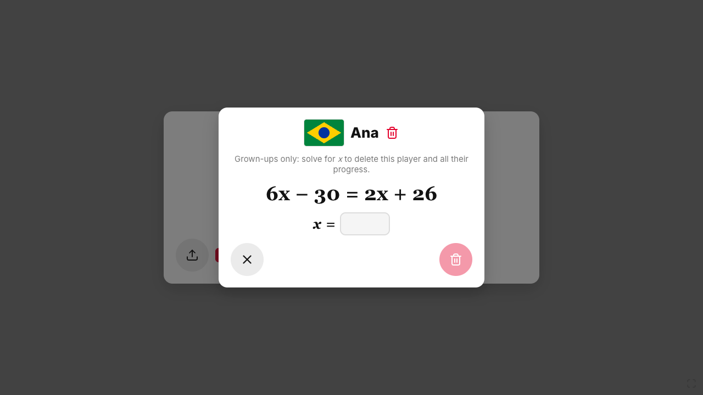 | |
| Splash screen | Deleting a player (grown-ups only) | |

---

## 🙌 Contributing

⭐ Don't forget to star this repository if you find it useful! ⭐

Thank you for considering contributing to this project! Contributions are highly appreciated and welcomed. To ensure smooth collaboration, please refer to our [Contribution Guidelines](./CONTRIBUTING.md).

**Translations**: the interface texts are in [`src/locales/`](src/locales/), one file per language, with English ([`en.ts`](src/locales/en.ts)) as the reference. All non-English translations were written with an AI assistant, so corrections from native speakers are especially welcome (in particular Amharic, Javanese, Sundanese, Maltese, Icelandic, Irish, Georgian and the languages of South and Southeast Asia). To add a language, add it to [`src/lib/languages.ts`](src/lib/languages.ts) and [`scripts/fetch-names.mjs`](scripts/fetch-names.mjs), copy `en.ts`, translate it, and run `npm run fetch-names`, `npm run build-credits` and `npm test` (the tests check that every message and placeholder is there).

---

## 🔐 Security

Please report vulnerabilities privately, as described in [SECURITY.md](./SECURITY.md).

---

## ✨ Maintainers

See [MAINTAINERS.md](./MAINTAINERS.md) for maintainers, mentors, and ideators.

---

## 📍 License

This project is licensed under the GNU General Public License v3.0.
See the [LICENSE](LICENSE) file for details.

The flag images are in the public domain (see [hampusborgos/country-flags](https://github.com/hampusborgos/country-flags)). Population and continent data © [GeoNames](https://www.geonames.org/), licensed under [CC BY 4.0](https://creativecommons.org/licenses/by/4.0/). Capitals from Wikidata (CC0); map from Natural Earth (public domain). The photos of capitals are from Wikimedia Commons under their own free licences (mostly CC BY and CC BY-SA); each photo's author, licence and source are listed in [`public/credits.html`](public/credits.html) and in `src/data/capitals.ts`. The AOSSIE logo is used according to the [AOSSIE brand guidelines](https://github.com/AOSSIE-Org/Info/blob/main/Brand.md).

---

## 💪 Thanks To All Contributors

Thanks a lot for spending your time helping Flag Quiz grow. Keep rocking 🥂

[](https://github.com/AOSSIE-Org/FlagQuiz/graphs/contributors)

© 2026 AOSSIE
